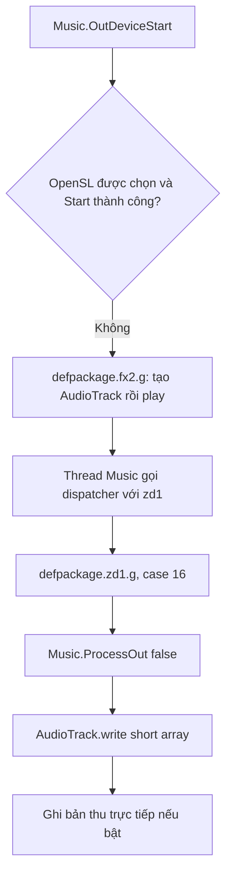

# Nhánh fallback AudioTrack

Cập nhật: đã tìm được [nơi nạp mode và nhãn cài đặt](CAI-DAT-AM-THANH.md) trong `MainActivity.O0`; phần chưa xác định ở cuối báo cáo này đã được bổ sung tại đó.

Đã đọc bằng REA/JADX, không chạy ứng dụng. Bằng chứng gốc giữ trong `fallback-create.json`, `fallback-write.json`, `out-format-set.json`, `latency-set.json` và `latency-set-callers.json`.

## Luồng đã nối



Các lớp có tên rút gọn nằm trong namespace `defpackage`. Tìm `fx2` còn trả về `ads_mobile_sdk.fx2`; lớp quảng cáo này không phải lớp tạo AudioTrack đang phân tích. Tên đầy đủ và thân hàm được kiểm tra để tránh nhầm.

## Khởi tạo

`defpackage.fx2.g(Object)` lấy cấu hình sample rate và buffer size, lưu đối tượng `Music` vào `b60.g`, còn `AudioTrack` vào `b60.d`. Các cách tạo được thử theo thứ tự:

1. Khi SDK >= 26: constructor có `AudioAttributes` và `AudioFormat`, truyền usage `1`, content type `2`, encoding `2`, channel mask `12`, buffer size, transfer mode `1`, session `0`.
2. Nếu chưa có đối tượng và SDK >= 26: thử `AudioTrack.Builder` với cùng các giá trị format và buffer size.
3. Nếu vẫn chưa có: thử constructor cũ với các giá trị `(3, sampleRate, 12, 2, bufferBytes, 1)`.

Sau đó gọi `play()` nếu đối tượng khác null. Mỗi bước bắt và bỏ qua exception. Không thấy kiểm tra `getState()` trong thân hàm này, nên việc constructor trả đối tượng không đủ chứng minh thiết bị đã phát thành công.

Các số trên được giữ nguyên từ APK; quan sát chắc chắn nhất là đường ghi dùng `short[]` do bộ trộn stereo đã phân tích tạo ra. Chưa đo format thực tế được thiết bị chấp nhận.

## Vòng ghi

`defpackage.zd1.g(Object)`, nhánh `case 16`:

```text
music.ProcessOut(false)
audioTrack.write(music.fOutBuffer, 0, music.fOutBufferSize * 2)
if directRecordWriter exists:
    directRecordWriter.c(buffer, frameCount)
```

Như vậy fallback tái sử dụng bộ trộn `Channels.Process` và các hiệu ứng trong `Music.ProcessOut`; chỉ thay tầng đưa buffer tới hệ thống âm thanh. Thân hàm này không kiểm tra giá trị trả về của `write`, không retry theo số phần tử đã ghi và bắt exception rồi trả về. Đây là đặc điểm mã quan sát được, chưa chứng minh lỗi hoặc mất âm xảy ra trên thiết bị.

`zd1` còn có các nhánh khác xử lý SoundPool. Không được gán mọi lời gọi `zd1.g` cho AudioTrack; chỉ nhánh `case 16` đã nối với đường phát này.

## Đổi format và lựa chọn chế độ

`Music.OutFormatSet(sampleRate, bits, channels, bufferCount)` ghi nhận trạng thái đang phát, dừng thiết bị nếu đang hoạt động, cấu hình lại reverb khi cần, cập nhật bốn field rồi khởi động lại nếu trước đó đang phát. Mã Java suy dịch có các khối try/catch phức tạp; chưa kiểm chứng đầy đủ đường exception.

`set_fLowLatencyMethod(int)` chỉ gán field. `trace-android-references` trả 0 using-node cho setter; điều này chỉ nói không tìm thấy caller theo quan hệ JADX, không chứng minh field không được gán trực tiếp hoặc dùng qua reflection. Chưa xác định preference key và nhãn giao diện tương ứng các giá trị mode. Không có cơ sở để khuyến nghị người dùng đổi một giá trị cài đặt cụ thể lúc này.

## Độ phủ hiện tại

Đã nối cả ba đường: callback OpenSL, thread ghi OpenSL và fallback AudioTrack. Chưa xác nhận thiết bị nào chọn đường nào, sample rate hiệu dụng, underrun, độ trễ hoặc CPU. Nghiên cứu tiếp có thể lần theo nơi ghi trực tiếp `fLowLatencyMethod` và kiểm chứng một cấu hình thực tế trên Android.
