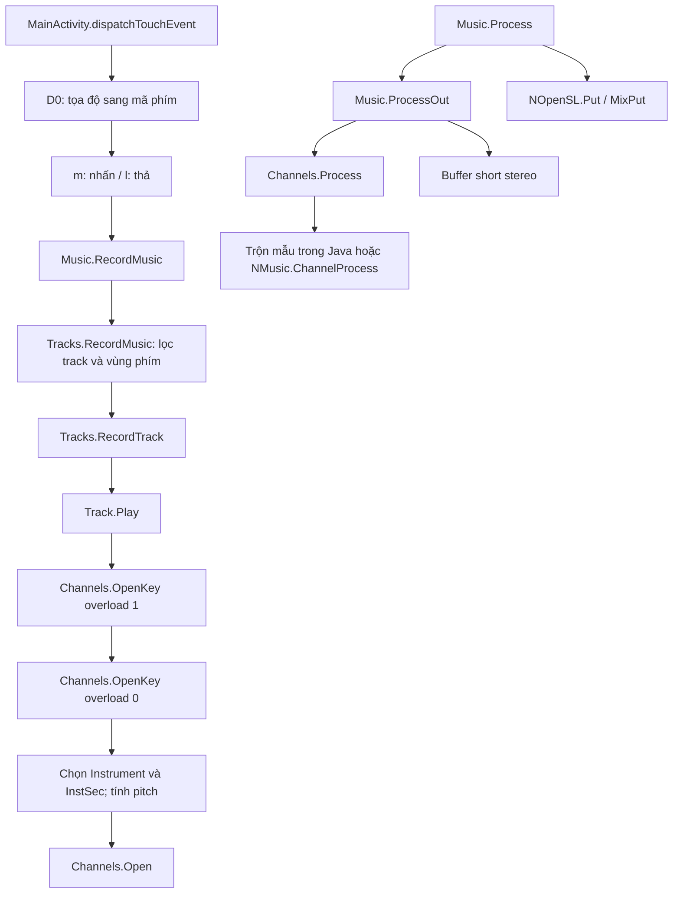

# Luồng bấm phím → phát âm thanh

Phân tích tiếp: [mã native ARM64](NATIVE-AUDIO.md). Đã đọc thân năm điểm JNI bằng disassembly; `NOpenSL.Put` chuẩn bị buffer native, chưa trực tiếp chứng minh thao tác enqueue ra thiết bị.

Kết quả đọc tĩnh APK `2026.10.01` bằng REA 6.5.0 / JADX 0.7.1. Các file JSON giữ bằng chứng gốc; `source/` chứa văn bản Java do decompiler tạo, không phải mã nguồn gốc và có thể không biên dịch được.

## Sơ đồ các bước

Đã nối các lời gọi Java trong sơ đồ bằng thân hàm. Sơ đồ rút gọn các nhánh script, ghi rhythm, kết nối nốt và SoundPool; không đại diện mọi chế độ chạy.

## 1. Nhận thao tác và xác định nốt

`sofeh.android.MainActivity.dispatchTouchEvent(MotionEvent)` đọc action, pointer ID và tọa độ. Mã xử lý tối đa 20 pointer trong vòng lặp này; đây không phải kết quả đo khả năng đa chạm của thiết bị.

Vùng dưới chiều cao của view `I` được xử lý như vùng phím. `D0(x, y)` gọi `E0(...)`; chế độ `X1 == 1` thử hai vùng với các tham số octave khác nhau.

Đã đọc `E0`: nó kiểm tra các pitch class `1, 3, 6, 8, 10` (phím đen) trước. Vị trí ngang dùng độ rộng phím trắng `Y`, bảng dịch `S` và độ rộng phím đen `Z`; chiều dọc dùng giới hạn vùng được truyền vào. Nếu không trúng phím đen, nó xét các pitch class còn lại như phím trắng, trừ trường hợp cờ `P0` chặn vùng phía trên. Mép trái dùng so sánh `>`, mép phải dùng `<=`. Nốt trả về bị giới hạn trong `0..127`, hoặc `-1` khi không trúng vùng. Chưa đọc chỗ khởi tạo `S/Y/Z`, nên chưa có tỷ lệ kích thước cụ thể. Bằng chứng bổ sung: `key-hit-test.json`.

Hàm so sánh trạng thái mới với `Music.fKeySet` cho 128 mã phím:

- Phím mới nhấn: gọi `m(note, value, flag, true)`.
- Phím đã thả: gọi `l(note, true)`.
- Khi di chuyển có các sự kiện điều khiển `51`, `52`, `53`; chưa đặt tên chính thức cho từng mã.

Bằng chứng: `touch.json`, `touch-D0.json`, `touch-m.json`, `touch-l.json`.

## 2. Sự kiện nhấn/thả và MIDI

Trong chế độ thông thường, `m` gọi `Music.RecordMusic(2, -1, note, value)` hoặc mã `4` theo cờ. `l` gửi mã `1`. Chưa xác định trọn vẹn khác biệt giữa mã `2` và `4`.

Khi các điều kiện thiết bị và cấu hình cho phép, hai hàm còn gọi `sendMidiNoteOn` / `sendMidiNoteOff` cho thiết bị USB và Bluetooth. Note Off dùng velocity `64`. Luồng MIDI này là nhánh riêng, không phải điều kiện bắt buộc để phát âm nội bộ.

Khi đang ghi rhythm, chúng chuyển sang `RecordRhythmTrack`; luồng đó chưa được lần tiếp.

## 3. Phân phối nốt đến track

`Music.RecordMusic` chỉ chuyển tiếp đến `fTracks.RecordMusic`.

`Tracks.RecordMusic` cập nhật `fKeySet`, duyệt `fTracksMain`, và với Note On yêu cầu track có `fRecord` và nốt nằm trong `fKeyAreaFromKey..fKeyAreaToKey`. Note Off đi qua điều kiện rộng hơn. Một nhánh track loại `3` cập nhật `fChordKeySet`, nhận dạng hợp âm và gọi `RecordChord`/`RecordChordStop`.

`Tracks.RecordTrack(Track, short, int, int, int)` tạo ID sự kiện có thành phần gắn với nốt, rồi gọi overload 7 tham số của `track.Play(...)`. Chỉ khi `fPlayMode == 4` nó gọi thêm `track.RecordMusic(...)`. Vì vậy tên `RecordMusic` không có nghĩa mọi lần nhấn đều ghi thành bản thu.

Bằng chứng: `record-music.json`, `tracks-record.json`, `record-track-main.json`.

Đã đọc thêm cả hai overload `Track.Play`: overload 7 tham số chuyển tiếp đến overload 9 tham số. Trong nhánh nhấn phím, overload này gọi `Channels.OpenKey` overload `1`, truyền `this.fInstrument`, `this.fSystem`, touch/balance, pitch move và pedal. Nhánh thả có lời gọi `Channels.Close(id)`. Có các hook script có thể thay đổi đường đi. JADX báo lỗi suy luận kiểu trong overload lớn; cần đối chiếu smali trước khi sao chép điều kiện hoặc công thức. Bằng chứng: `track-play-main.json`, `track-play-dispatch.json`.

## 4. Chọn nhạc cụ, mẫu âm và cao độ

`Channels.OpenKey`, overload `0`, có các bước đã đọc được:

1. Lấy `Instrument` bằng `fMusic.fInstruments.Get(i6)`.
2. Áp dụng các giá trị transpose/octave/tuning theo loại nhạc cụ và cấu hình.
3. Chọn `InstSec` trong `instrument.fSndList[...].fList[...]`. Với `PitchMode == 0`, mã tìm section tồn tại gần nốt đích nhất; mode `2` yêu cầu section đúng nốt. Mode `1` có mã suy dịch phức tạp và vòng lặp bất thường, cần kiểm tra smali trước khi diễn giải.
4. Tính bước đọc mẫu bằng `KeyToPitchEx(...) * section.SampleRate / outputSampleRate`, với thang vị trí `8192`.
5. Gọi `Open(...)`, truyền pitch, volume, các giá trị envelope và `InstSec`.

Cũng có nhánh gọi `SoundPool.play`. Chưa xác nhận trong runtime khi nào APK chọn nhánh này.

Đã đọc overload trung gian `OpenKey` số `1`: nếu nhạc cụ không có mode, nó gọi overload `0` với sound index `0`. Nếu có mode, nó dùng `InstMode.Sound`, thay bằng `InstMode.Aftertouch` khi cờ tương ứng bật và chỉ số hợp lệ. Sau đó nó duyệt `InstMode.Mix` để mở thêm layer, điều chỉnh volume bằng `((MixVol + 100) * value) / 100` và cộng pan `MixPan`. Một nốt vì thế có thể tạo nhiều voice. Bằng chứng: `open-key-wrapper.json`.

`Channels.Open` chọn giới hạn voice theo `fMaxMusicChannel` hoặc `fMaxRhythmChannel`. Với yêu cầu mở mới (`i12 == -1`), nó tìm slot có `idx == 0`; khi hết slot, chọn slot có `idx` nhỏ nhất. Đây là cơ chế thay voice theo bộ đếm thứ tự, chưa phải kết quả đo âm học. Với mixer `3`, bước tạo slot gọi `NMusic.ChannelOpen`. Mở mới gọi `ChannelReset`, đặt ID, nốt, pitch, volume, envelope, `InstSec`, `Position = 0`, `Close = false` và bộ đếm mới. Khi có chỉ số slot cụ thể, nó chỉ cập nhật một nhóm thuộc tính rồi trả về. Bằng chứng: `channel-open.json`.

`Channels.Close(id)` chuyển đến `Close(id, false)`. Hàm duyệt các slot đang hoạt động và đặt `Close = true` cho mọi voice trùng ID; nếu đối số boolean bật thì đặt thêm `PedalMode = 0`. Nó không xóa voice hoặc tắt âm tức thì. Trong chu kỳ xử lý tiếp theo, `Channels.Process` đọc cờ này để chuyển envelope sang release, sau đó mới xóa voice theo điều kiện kết thúc. Cơ chế này giải thích vì sao một nốt có thể tiếp tục ngân sau khi thả. Bằng chứng: `channel-close.json`, `channel-release.json`, `channels-process.json`.

Bằng chứng: `open-key.json`, `source/open-key.java`.

## 5. Tạo và xuất buffer âm thanh

`Music.ProcessOut` gọi `fTracks.PlayNext()`, xóa các buffer trái/phải, rồi gọi `track.fChannels.Process()` cho các track đang có kênh hoặc hiệu ứng.

`Channels.Process` cập nhật pitch, volume, các giai đoạn attack/decay/sustain/release và vị trí đọc mẫu. Khi section dùng `WaveB`, nó gọi `NMusic.ChannelProcess(...)`. Với `WaveA`, có các nhánh trộn mẫu ngay trong Java, gồm nội suy tuyến tính và công thức dùng bốn điểm mẫu. Không phải mọi mẫu âm đều đi qua cùng một nhánh native.

`Music.ProcessOut` cộng các bus music/wave/rhythm, áp dụng hiệu ứng, fade và global reverb nếu bật, sau đó ghi buffer `short[]` xen kẽ trái/phải.

`Music.Process` gọi `ProcessOut(false)` rồi:

- `NOpenSL.Put(fOutBuffer, size)` khi không trộn đầu vào thu âm.
- `ProcessIn(...)` và `NOpenSL.MixPut(...)` khi đầu vào OpenSL đang hoạt động.

Đã kiểm tra bảng ký hiệu động ELF của hai thư viện ARM64, không chạy mã: `libnmusic.so` định nghĩa hàm `Java_sofeh_music_NMusic_ChannelProcess` (địa chỉ tương đối ELF `0x248c`, kích thước 2.816 byte); `libnopensl.so` định nghĩa `Java_sofeh_audio_NOpenSL_Put` (`0xf28`, 156 byte) và `MixPut` (`0x1240`, 792 byte). `slCreateEngine` là ký hiệu được nhập, không phải hàm do thư viện này định nghĩa. Đây là bằng chứng về các điểm nối JNI và phụ thuộc OpenSL ES; chưa phải phân tích thân hàm hoặc quan sát lời gọi runtime. Địa chỉ trên không phải địa chỉ tuyệt đối của tiến trình.

Kết quả và SHA-256 từng thư viện nằm trong `native-dynamic-symbols.csv`; script `inspect_native_symbols.py` cho phép đọc lại bảng ký hiệu từ APK. File `native-jni-strings.csv` là bước dò chuỗi sơ bộ, có độ chắc chắn thấp hơn bảng ký hiệu. Chưa đo độ trễ hoặc đọc mã máy native.

Bằng chứng: `music-Process.json`, `music-ProcessOut.json`, `channels-process.json`, `nmusic.json`.

## Có thể tự triển khai gì?

Có thể xây một bản thử độc lập theo chuỗi: hit-test phím → Note On/Off → bộ định tuyến split/layer → chọn mẫu gần nốt → voice có envelope và pitch → mixer stereo → đầu ra âm thanh. Dùng mẫu âm tự tạo hoặc được cấp quyền. Đây là thiết kế tham khảo từ quan sát, chưa phải bản tái tạo tương đương ORG 24.

Bước nghiên cứu còn lại: kiểm tra chính xác các nhánh script/legato và khởi tạo kích thước bàn phím, đọc mã máy các điểm JNI, rồi xác minh bằng thao tác thực tế trên thiết bị. Định dạng SET và cách giải mã dữ liệu nhạc cụ chưa được phân tích ở lượt này.
